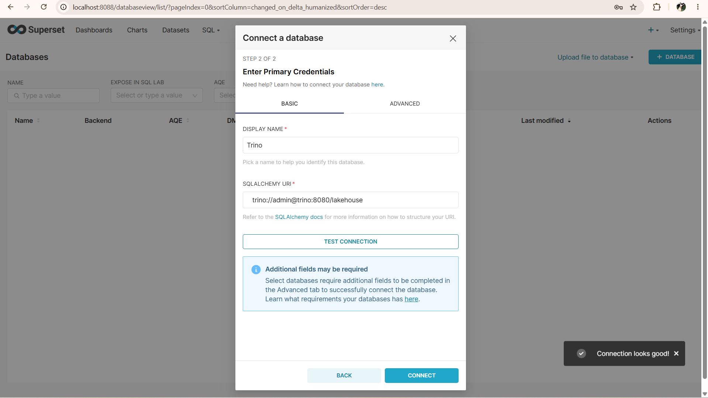
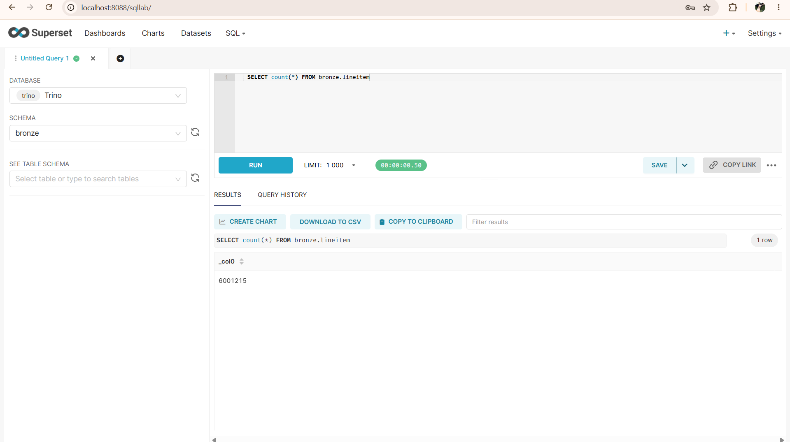

# Практическая №1 — локальный Lakehouse, ELT и бенчмарк (вариант 3, TPC-H Q18)

Стек: MinIO + PostgreSQL + Lakekeeper (Iceberg REST Catalog) + Trino (+ Superset). Слои: bronze → silver → gold. Масштаб данных: sf1.

## Архитектура

```
 tpch (генератор)                                   Superset (BI, часть 2)
        │                                                  │
        ▼                                                  ▼
     Trino  ──── метаданные ───►  Lakekeeper (REST) ──► PostgreSQL
        │
        └──── parquet-файлы ───►  MinIO (S3, бакет "lakehouse")

 Слои:  bronze (сырое)  →  silver (очищено + обогащено)  →  gold (витрина Q18)
```

## 1. Вариант и масштаб

| Поле | Значение |
|---|---|
| ФИО (как в VK Education) | Недопекина Анна Сергеевна |
| Вариант (запрос) | 3 — Q18 «Large Volume Customer» |
| Масштаб sfN | sf1 |
| Почему выбрал такой масштаб | sf1 — это ≈ 8,7 млн строк (lineitem ≈ 6 млн), около 1 ГБ сырых данных. Этого достаточно, чтобы увидеть реальную разницу между кодеками и тяжёлый джойн с подзапросом, но всё помещается в память ноутбука, а бенчмарк из 6 пересозданий Bronze проходит за минуты. sf10 дал бы ×10 по времени и диску без нового понимания; sf0.01 слишком мал — разница кодеков терялась бы в шуме. |

## 2. Поднятые сервисы

| Сервис | Роль в стеке | Почему именно он (а не альтернатива) |
|---|---|---|
| MinIO | S3-совместимое объектное хранилище, сюда падают parquet-файлы | Открытый исходный код, полностью S3-совместим (любой S3-инструмент работает без изменений), поднимается одним контейнером, бесплатный. Альтернатива HDFS тяжелее в развёртывании; реальный AWS S3 платный и требует интернета. |
| PostgreSQL | БД, где Lakekeeper хранит метаданные каталога | Lakekeeper поддерживает именно Postgres; надёжная, транзакционная (важно для атомарных коммитов каталога), бесплатная. |
| Lakekeeper | Iceberg REST Catalog — каталог метаданных таблиц | REST-каталог — открытый стандарт Iceberg: любой движок (Trino, Spark, Doris) работает с одним каталогом. Лёгкий (написан на Rust), один контейнер. Альтернативы (Hive Metastore, Nessie) тяжелее или привязаны к конкретным движкам. |
| Trino | SQL-движок: ходит в Lakekeeper за метаданными, читает/пишет данные в MinIO | Распределённый MPP-движок, стандартный SQL (нужен Q18 с подзапросом), нативный Iceberg-коннектор, встроенный генератор TPC-H (`tpch`), поддержка time travel и schema evolution. Альтернатива Spark тяжелее для интерактивных запросов. |
| Superset | BI-инструмент поверх lakehouse (часть 2) | Открытый, бесплатный, работает с Trino через SQLAlchemy-драйвер, есть SQL Lab для быстрой проверки Bronze. |

Официальные образы MinIO сняты с публичных реестров, поэтому использован образ сообщества coollabsio/minio — сборка того же MinIO


### Скрипты, которыми поднимала стек

Весь стек описан в [`docker-compose.yml`](docker-compose.yml):

```bash
docker compose up -d --build         # MinIO, PostgreSQL,
                                     # lakekeeper-migrate (схема БД), Lakekeeper, Trino
python scripts/01_bootstrap.py       # создать бакет в MinIO; Lakekeeper: принять условия + создать warehouse "lakehouse" -> MinIO
docker compose --profile bi up -d --build   # Superset (часть 2)
docker ps                            # проверка
```

```
NAMES             IMAGE                                           STATUS                    PORTS
trino             trinodb/trino:476                               Up 11 minutes (healthy)   0.0.0.0:8080->8080/tcp, [::]:8080->8080/tcp
lakekeeper        quay.io/lakekeeper/catalog:latest-main          Up 11 minutes             0.0.0.0:8181->8181/tcp, [::]:8181->8181/tcp
lakehouse-pg      postgres:16                                     Up 11 minutes (healthy)   5432/tcp
lakehouse-minio   coollabsio/minio:RELEASE.2025-10-15T17-29-55Z   Up 11 minutes             0.0.0.0:9000-9001->9000-9001/tcp, [::]:9000-9001->9000-9001/tcp
```

## 3. Разбор запроса Q18 — какие данные нужны

| Таблица TPC-H | Нужные колонки | Что запрос с ними делает |
|---|---|---|
| customer | `custkey`, `name` | `custkey` — джойн с orders; `name` — вывод и группировка |
| orders | `orderkey`, `custkey`, `orderdate`, `totalprice` | `custkey` — джойн с customer; `orderkey` — джойн с lineitem и фильтр `IN`; `orderdate`, `totalprice` — вывод, группировка и сортировка |
| lineitem | `orderkey`, `quantity` | `orderkey` — джойн и группировка в подзапросе; `quantity` — агрегат `sum(quantity)`: в подзапросе `HAVING > 300` и в выводе `total_quantity` |

Итого запрос использует 3 таблицы, 8 колонок из 8+9+16 (остальные в Q18 не нужны). Остальные таблицы TPC-H (nation, part и т. д.) не требуются.

## 4. Медальон — решения по каждому слою

### Bronze (сырой)

| Таблица | Колонки (что оставил) | Строк | Вес, МБ | Формат | Сжатие | Партиц. | Обоснование |
|---|---|---|---|---|---|---|---|
| customer | все (8) | 150 000 | 7.807 | PARQUET | ZSTD | нет | Bronze хранит сырьё без потерь, поэтому все колонки. Parquet колоночный — читаются только нужные колонки; ZSTD — лучшее соотношение размер/скорость (см. п. 5). Таблица мала — партиции только создадут мелкие файлы. |
| orders | все (9) | 1 500 000 | 34.964 | PARQUET | ZSTD | нет | То же. Запрос не фильтрует по дате, поэтому партиционирование по `orderdate` ничего не ускорило бы. |
| lineitem | все (16) | 6 001 215 | 147.242 | PARQUET | ZSTD | нет | Самая большая таблица; Q18 читает всего 2 колонки из 16 — колоночный формат тут решающий. Партиционирование не нужно: нет фильтра по ключу партиции, а `orderkey` слишком высококардинален. |

### Silver (очищенный)

| Таблица | Колонки | Строк | Вес, МБ | Формат | Сжатие | Партиц. | Обоснование |
|---|---|---|---|---|---|---|---|
| large_orders | orderkey, total_quantity | 57 | 0.001 | PARQUET | ZSTD | нет | Результат подзапроса Q18: «крупные» заказы. Очень маленькая таблица. |
| large_order_lines | custkey, customer_name, orderkey, orderdate, order_year, totalprice, linenumber, quantity | 399 | 0.004 | PARQUET | ZSTD | нет | Факт «строки крупных заказов»: джойн customer↔orders↔lineitem. Очистка: trim имени, отсев NULL/некорректных значений; обогащение: `order_year`. Данных мало (сотни строк) — партиционирование по `order_year` дало бы файлы по несколько КБ и замедлило бы чтение. |

### Gold (витрина)

| Таблица | Колонки | Строк | Вес, МБ | Формат | Сжатие | Партиц. | Обоснование |
|---|---|---|---|---|---|---|---|
| top_large_volume_customers | name, custkey, orderkey, orderdate, totalprice, total_quantity | 57 | 0.002 | PARQUET | ZSTD | нет | Прямой ответ на Q18. Единый формат со всеми слоями, чтобы BI читал её без особенностей. Размер — килобайты, оптимизировать нечего. |

*Заметка:* при sf1 условие `sum(quantity) > 300` выполняют всего 57 заказов, поэтому «топ-100» фактически содержит 57 строк — это нормально и совпадает с эталонным Q18 (проверено скриптом).

## 5. Тесты производительности

Результаты `scripts/03_benchmark.py` (файл `results/benchmark.md`):

| Формат | Сжатие | Размер Bronze, МБ | Время записи, c | Q18 (медиана), c | Агрегация lineitem, c |
|---|---|---|---|---|---|
| PARQUET | NONE | 486.4 | 11.2 | 1.17 | 0.3 |
| PARQUET | SNAPPY | 261.2 | 10.6 | 1.06 | 0.35 |
| PARQUET | GZIP | 184.8 | 23.9 | 1.0 | 0.39 |
| PARQUET | ZSTD | 190.0 | 11.5 | 0.82 | 0.28 |

**Вывод по моим замерам:** наименьший размер Bronze — PARQUET+GZIP (184.8 МБ), наибольший — PARQUET+NONE (486.4 МБ); самая быстрая запись — PARQUET+SNAPPY (10.6 с); самый быстрый Q18 — PARQUET+ZSTD (0.82 с); самая быстрая агрегация — PARQUET+ZSTD (0.28 с); ZSTD уменьшает размер в 2.6 раза относительно несжатого Parquet, при этом запись медленнее в 1.03 раза, а Q18 — в 0.70 раза; GZIP относительно ZSTD: размер ×0.97, запись ×2.08.

**Интерпретация.** Без сжатия файлы самые большие. GZIP обычно сжимает сильнее всех, но пишется медленнее; SNAPPY быстрый, но сжимает слабее; ZSTD — компромисс между ними. Поэтому Bronze хранится в Parquet+ZSTD, если замеры выше это подтверждают. На sf1 данные помещаются в кэш, поэтому разница во времени запросов небольшая, а главный выигрыш от сжатия — размер на диске и в S3 и меньший объём чтения по сети. Parquet и ORC — оба колоночные форматы, существенной разницы между ними на этом объёме быть не должно.

Методика: 1 прогрев + 3 замера, медиана (в режиме `--quick` — 2 замера, только Parquet); время из `elapsedTimeMillis` Trino.

## 6. Часть 2 — осмысление и работа с инструментами

### 6.1. Понять и объяснить

| Вопрос | Ответ |
|---|---|
| Зачем нужны большие данные и lakehouse (а не обычная БД/хранилище)? | Данных стало слишком много (и они разнородные), чтобы держать их в одной обычной БД: масштабировать диск и сервер дорого. Data lake (файлы в S3) дёшев и хранит что угодно, но в нём нет транзакций, схем и удобного SQL. Lakehouse соединяет оба подхода: дешёвое хранение в открытых форматах (Parquet) + слой метаданных (Iceberg) даёт таблицы с транзакциями, изменением схемы и откатом. Хранение (MinIO) и вычисления (Trino) масштабируются отдельно, а один и тот же набор данных могут читать разные движки без копирования. |
| Пример schema evolution на Silver | `ALTER TABLE silver.large_order_lines ADD COLUMN note varchar` — у всех старых строк `note = NULL`, **файлы в MinIO не переписывались** (изменились только метаданные). `RENAME COLUMN note TO remark` — данные стали доступны под новым именем так же мгновенно. Iceberg отслеживает колонки по ID, а не по имени, поэтому переименование ничего не ломает. Фактический лог — в конце раздела 6.1. |
| Пример скрипта восстановления из снапшота (time travel) | См. `scripts/04_part2_demo.py`. Суть: запомнить `snapshot_id` из `"large_order_lines$snapshots"`; случайно удалить: `DELETE FROM … WHERE order_year = 1992`; посмотреть прошлое: `SELECT count(*) FROM … FOR VERSION AS OF <id>`; откатить: `CALL lakehouse.system.rollback_to_snapshot('silver','large_order_lines',<id>)`; убедиться, что число строк вернулось. Работает, потому что Iceberg не стирает старые файлы сразу, а лишь создаёт новый снапшот. Фактический лог — ниже. |

**Фактический вывод скрипта `scripts/04_part2_demo.py`:**

```
### SCHEMA EVOLUTION
>> SELECT count(*) FROM lakehouse.silver.large_order_lines
   [399]
>> ALTER TABLE lakehouse.silver.large_order_lines ADD COLUMN note varchar
>> SELECT orderkey, quantity, note FROM lakehouse.silver.large_order_lines LIMIT 3
   [1971680, 49.0, None]
   [1971680, 44.0, None]
   [1971680, 34.0, None]
>> ALTER TABLE lakehouse.silver.large_order_lines RENAME COLUMN note TO remark
>> SELECT orderkey, quantity, remark FROM lakehouse.silver.large_order_lines LIMIT 3
   [1971680, 34.0, None]
   [1971680, 49.0, None]
   [1971680, 44.0, None]

### TIME TRAVEL (откат после 'случайного' удаления)
>> SELECT snapshot_id, committed_at, operation FROM lakehouse.silver."large_order_lines$snapshots" ORDER BY committed_at
   [8967979814424129043, '2026-10-18 15:05:11.005 UTC', 'append']
>> SELECT count(*) FROM lakehouse.silver.large_order_lines
   [399]
Запомнили снапшот: 8967979814424129043 строк: 399
>> DELETE FROM lakehouse.silver.large_order_lines WHERE order_year = 1992
   [35]
>> SELECT count(*) FROM lakehouse.silver.large_order_lines
   [364]
После удаления строк: 364
>> SELECT count(*) FROM lakehouse.silver.large_order_lines FOR VERSION AS OF 8967979814424129043
   [399]
>> CALL lakehouse.system.rollback_to_snapshot('silver', 'large_order_lines', 8967979814424129043)
>> SELECT count(*) FROM lakehouse.silver.large_order_lines
   [399]
После отката строк: 399 - совпало с исходным: True
```

### 6.2. Подключённый инструмент к lakehouse

| Инструмент | Почему выбрала именно его |
|---|---|
| Apache Superset (BI) | Открытый и бесплатный; подключается к Trino стандартным драйвером; есть SQL Lab для интерактивных запросов и графики поверх Gold. Для задачи «показать дашборд по Q18» BI подходит лучше, чем второй движок (Doris/StarRocks/Spark): мне нужен не ещё один способ считать, а способ показать результат. |

**Скрипты развёртывания:** `superset/Dockerfile` (Superset + драйвер Trino) и сервис `superset` в `docker-compose.yml`; запуск: `docker compose --profile bi up -d --build`.

**Мои действия в UI:**
1. Открыла http://localhost:8088, вошла `admin` / `admin`.
2. *Settings → Database Connections → + Database → Trino*, URI: `trino://admin@trino:8080/lakehouse`, *Test connection* → успешно.
3. *SQL Lab* → база Trino, схема `bronze` → выполнила `SELECT count(*) FROM bronze.lineitem` и `SELECT * FROM bronze.orders LIMIT 10` — данные Bronze видны.
4. Создала график по `gold.top_large_volume_customers`.





## 7. Выводы

Медальон разделяет ответственность: Bronze хранит сырьё без потерь (можно перестроить всё остальное), Silver — очищенные и объединённые данные, Gold — готовый ответ для бизнеса, поэтому аналитику не нужно знать о джойнах и фильтрах. Формат Parquet с ZSTD выбран за колоночное чтение (Q18 берёт 2 колонки из 16 в lineitem) и как компромисс между размером и скоростью; этот выбор проверяется бенчмарком в п. 5. Партиционирование не применялось, потому что на sf1 нет фильтров по ключу партиции, а таблицы Silver/Gold крошечные — оно только создало бы мелкие файлы. Связка MinIO + Lakekeeper + Trino полностью открытая, не привязана к одному вендору и допускает подключение других движков к тем же данным. Iceberg дал schema evolution и откат без переписывания данных, чего нет у «голых» файлов.

---

